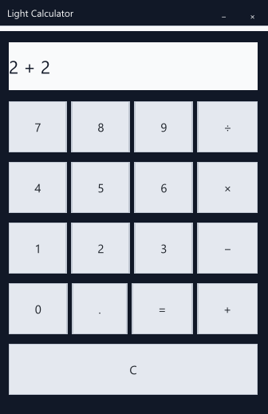
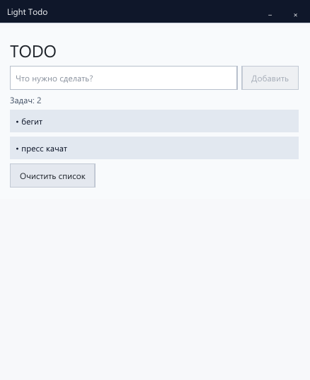
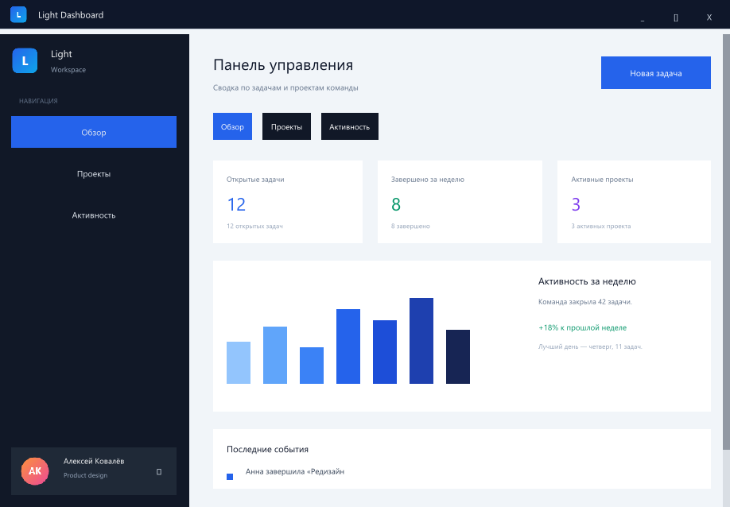
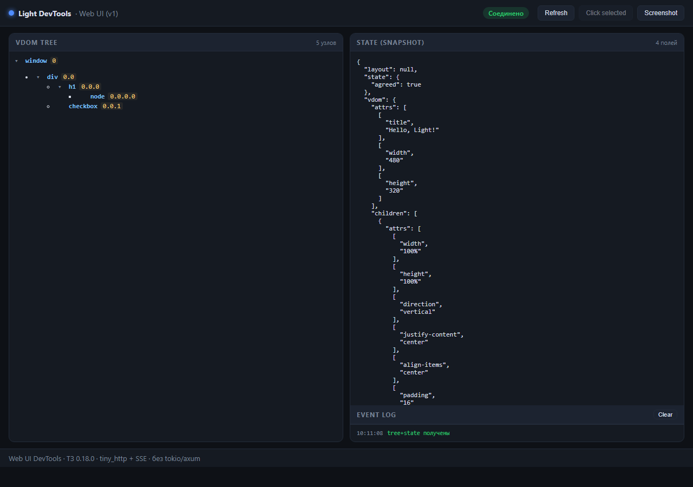

# Light

[](https://github.com/gifoff/light/actions/workflows/ci.yml)
[](https://gifoff.github.io/light/)
[](https://crates.io/crates/light)

Light — декларативный реактивный GUI-фреймворк для Rust. Вы пишете HTML-разметку с директивами (`v-if`, `v-for`, `v-model`), описываете состояние реактивными свойствами (`#[proxy]`), а Light компилирует шаблоны **на этапе сборки** в Rust-код, строящий виртуальный DOM. 

Окна создаются на `winit`, а программно нарисованный кадр показывается через `softbuffer`; `wgpu` доступен отдельной фичей. Light даёт привычный DX (как в Vue.js), но с производительностью и надёжностью нативного Rust.

Начиная с **0.20.0** ядро (`light-fw-core`) не тянет GUI-зависимости: GUI-модули (окно, paint, a11y, рендер-бэкенды) вынесены в отдельный крейт `light-gui`. Для headless-приложений (API-серверы, тесты без окна) используйте `light-fw-core` без фичи `window` — бинарник не будет содержать winit/softbuffer/pixels/rfd/accesskit.

## Зачем использовать Light?

- **CLI для всего.** `light init`, `light dev`, `light build` — вам не нужно вручную настраивать сборку и зависимости.
- **Компиляция вместо интерпретации.** Шаблоны превращаются в Rust на этапе сборки. В рантайме нет HTML-парсера и интерпретатора разметки.
- **Гранулярная реактивность.** Изменение свойства перерисовывает только зависящие узлы виртуального дерева.
- **Нативные окна.** Безрамочные окна, кастомный titlebar, модальные окна и несколько окон — из коробки.
- **Платите только за используемое.** Каждая подсистема — Cargo-фича; код выключенных возможностей не попадает в бинарник.
- **Дружелюбен к ИИ-агентам.** Уникальный `light devtools` позволяет автономным агентам тестировать UI и собирать скриншоты.

## 🚀 Быстрый старт (3 шага)

Самый простой способ создать проект — установить CLI и запустить `init`:

```bash
# 1. Устанавливаем CLI
cargo install light

# 2. Создаём проект
light init my-app
cd my-app

# 3. Запускаем с hot-reload
light dev
```

Готово! Откроется окно вашего первого приложения.

Доступны готовые шаблоны showcase-приложений (`counter`, `todo`, `calculator`):
```bash
light init my-app --template counter
```

## Статус

Текущая версия — **0.20.0**. Проект в стадии **пре-1.0**: публичный API ещё не стабилен и может меняться между минорными версиями. Мы следуем семверу.

**Модульность (новое в 0.20.0):** `light-fw-core` декомпозирован на 5 слоёв
(`light-reactivity`, `light-vdom`, `light-gui`, `light-render-cpu`,
`light-render-gpu`) и теперь **headless by default** — по умолчанию ядро не
тянет ни `winit`, ни `softbuffer`/`pixels`/`wgpu`, ни `accesskit*`, ни `rfd`.
GUI включается точечными фичами; фасад `light-fw` остаётся GUI-first для
`light init` / `light dev`. Headless-режим: `light-fw-core` с
`default-features = false` — см. [docs/guide.md](docs/guide.md#apicli-без-gui-headless-режим-0200).

**Breaking change (0.20.0):** payload'ы ошибок
`light_fw_core::error::Error` (`Window`, `CreateWindow`, `Surface`, `Texture`,
`Softbuffer`) теперь хранят текст ошибки (`String`), а не типизированные
`winit`/`pixels`/`softbuffer` ошибки. Обратная совместимость на уровне
`Display` сохраняется. Допустимо для 0.20.0 в силу масштабной перестройки
модульности.

**Plugin API** (0.19.0): плагины могут добавлять собственные HTML-теги через макрос `#[component(tag = "...")]` (крейт `light-fw-macros`). Кастомные теги автоматически обнаруживаются `light dev` и предлагаются к установке.

## Ручная сборка (без CLI)

Если вы предпочитаете классический `cargo` без использования CLI-утилиты, создайте проект вручную.

`Cargo.toml`:
```toml
[package]
name = "my-app"
version = "0.1.0"
edition = "2021"

[dependencies]
light-fw = "0.17"

[features]
dev-mode = ["light-fw/dev-mode"]
```

`src/main.rs`:
```rust
#![cfg_attr(not(debug_assertions), windows_subsystem = "windows")]

use light_fw::prelude::*;

#[template("templates/app.html")]
#[proxy]
struct App {
    #[default("Мир".to_owned())]
    name: String,
}

impl App {
    fn greet(&self) {
        self.set_name(format!("Привет, {}!", self.name()));
    }
}

fn main() -> light_fw::Result<()> {
    // run_with_config включает поддержку light.config.json и DevTools
    light_fw::run_with_config("light.config.json", App::new())
}
```

`templates/app.html`:
```html
<window title="My App" width="480" height="320">
    <div direction="vertical" padding="16">
        <h1>Привет, {{ name }}!</h1>
        <button @click="greet">Поздороваться</button>
    </div>
</window>
```

```bash
cargo run
# или cargo run --features dev-mode (для DevTools)
```
> **Примечание:** При использовании `cargo run` правки в HTML-файлах не подхватываются автоматически. Используйте `light dev` для горячей перезагрузки.

## Showcase

| Calculator | Todo | Dashboard |
| --- | --- | --- |
|  |  |  |

Полноценный dashboard с изображениями, вкладками и модальным окном:
```bash
cargo run -p example-dashboard
```

## Разработка и DevTools

Запустите `light dev` — Light поднимет supervisor, который следит за `templates/` и `src/`. 
- При изменении HTML мгновенно применяется `RELOAD_TEMPLATE` (без пересборки).
- При изменении `.rs` происходит инкрементальная пересборка с сохранением состояния окна.

Под капотом `light dev` также запускает TCP-сервер (порт `9229`), который отдаёт JSON-снимок состояния UI.

С версии 0.18 дополнительно поднимается Web UI DevTools на `http://127.0.0.1:9228`
— браузерный инспектор VDOM/State с кнопками клика и скриншота (флаг
`--no-web` для отключения, `--web-port <ПОРТ>` для смены порта).



### Agent-friendly DevTools (0.17+)

Light можно назвать первым GUI-фреймворком для Rust, спроектированным с учётом ИИ-агентов. 
Команда `light devtools` даёт агенту «увидеть» UI (дерево VDOM, раскладка, снимок состояния, скриншот) и «потрогать» его (клик, ввод текста, клавиши) по стабильным ключам узлов.

```bash
light dev --agent                 # Запускает приложение + записывает сессию агента
light devtools tree               # JSON-дерево VDOM
light devtools find --tag button  # Найти элемент (ключ + координаты)
light devtools click --key .0.1   # Программный клик
light devtools shot --path shots  # Сделать скриншот (PNG)
```

Флаг `--agent` создаёт `.light/agent-sessions/<id>/` с журналом действий (`actions.jsonl`) и генерирует `summary.md` — готовый отчёт с доказательствами для агента.

## Управление компонентами (CLI)

Light поддерживает модульные компоненты (например, элементы форм или валидацию).

```bash
light add light-fw-element-form          # Добавить компонент в проект
light search datepicker                  # Поиск Light-компонентов (интерактивный выбор)
light search datepicker --yes            # Авто-выбор + валидация (exit 0/1, для CI)
light search light-fw --json             # JSON-вывод для скриптов
```

Поиск ведётся в **настраиваемом реестре** (по умолчанию crates.io; переопределяется
секцией `registry` в `light.config.json`). Результаты ранжируются: официальный
(owner `gifoff`) → совпадение имени с запросом → количество загрузок.

Если вы используете компонент в шаблоне, но забыли его установить, `light dev` или `light build` автоматически обнаружат это и предложат установить (в неинтерактивном режиме — установят сами).

## Крейты воркспейса

Light разделён на крейты, чтобы вы подключали только то, что вам нужно:

| Крейт | Назначение |
| --- | --- |
| **`light`** | CLI-утилита (`cargo install light`): dev-сервер, сборка, менеджер компонентов. |
| **`light-fw`** | Фасад **GUI-first**: реэкспортирует ядро, макросы и подключённые компоненты (default-фичи: `elements-basic`, `window`, `softbuffer-backend`, `a11y-winit`). |
| **`light-fw-core`** | Ядро **headless by default** (0.20.0): фасад 0.19.x + re-export всех слоёв. Без окон/рендера/a11y в default-фичах. |
| **`light-reactivity`** | Сигналы: `Property`, `Proxy`, `Observer`, `Watcher`, `watch`. Вынесен из `light-fw-core` (0.20.0). |
| **`light-vdom`** | VDOM, layout, DOM, runtime, plugins, validation. Вынесен из `light-fw-core` (0.20.0). |
| **`light-gui`** | GUI-слой: окно на `winit`, a11y-мост AccessKit, `file_dialog`, `async_runtime`, devtools-инфраструктура. Вынесен из `light-fw-core` (0.20.0). |
| **`light-render-cpu`** | Программная отрисовка через `softbuffer` (CPU-бэкенд). Вынесен из `light-gui` (0.20.0). |
| **`light-render-gpu`** | Аппаратная отрисовка через `pixels` (wgpu/naga). Вынесен из `light-gui` (0.20.0). |
| **`light-fw-macros`** | Процедурные макросы `#[template]` и `#[proxy]`. |
| **`light-fw-html`** | Разбор HTML-шаблонов. |
| **`light-fw-element-form`** | Компонент-элемент: `<checkbox>`, `<radio>`, `<select>`. |
| **`light-fw-behavior-validation`** | Валидация: `required`, `:validator`, `@validate`. |
| **`light-fw-cli-core`** | Внутренняя логика CLI. |
| **`light-fw-devtools-web`** | Web UI DevTools (внутренний, публикуется как зависимость `light`). |

### Cargo-фичи (0.20.0)

| Крейт | Default-фичи | Ключевые фичи |
| --- | --- | --- |
| `light-fw-core` | `elements-basic` | `window`, `softbuffer-backend`, `wgpu-backend`, `a11y`, `a11y-winit`, `file-dialog`, `async-runtime`, `devtools`, `min-max-size`, `elements-*` |
| `light-fw` | `elements-basic`, `window`, `softbuffer-backend`, `a11y-winit` | те же, что у ядра + `dev-mode`, `hot-reload`, `runtime-templates`, `devtools` |
| `light-gui` | *(none)* | `window`, `a11y`, `file-dialog`, `async-runtime`, `devtools` |
| `light-render-cpu` | *(none)* | `window` |
| `light-render-gpu` | *(none)* | `window` |

Headless-режим: `light-fw-core` с `default-features = false` (см.
[docs/guide.md](docs/guide.md#apicli-без-gui-headless-режим-0200)).

## Документация

Сайт: [gifoff.github.io/light](https://gifoff.github.io/light/).

- [Быстрый старт](docs/quickstart.md) — установка и первый проект.
- [Руководство пользователя](docs/guide.md) — директивы, стили, события, окна, DevTools.
- [Справочник CLI](docs/cli.md) — все команды `light`.
- [Архитектура](docs/ARCHITECTURE.md) — устройство фреймворка для контрибьюторов.
- [Roadmap](docs/ROADMAP.md) — планы по развитию.

## Лицензия

Распространяется под лицензией `MIT OR Apache-2.0` на ваш выбор. Полные тексты — в файлах [LICENSE-MIT](LICENSE-MIT) и [LICENSE-APACHE](LICENSE-APACHE).