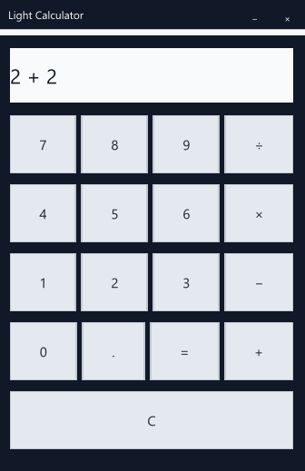
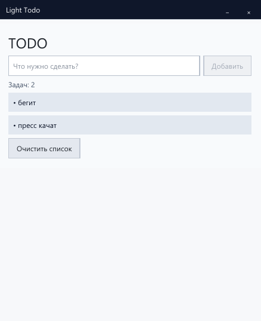
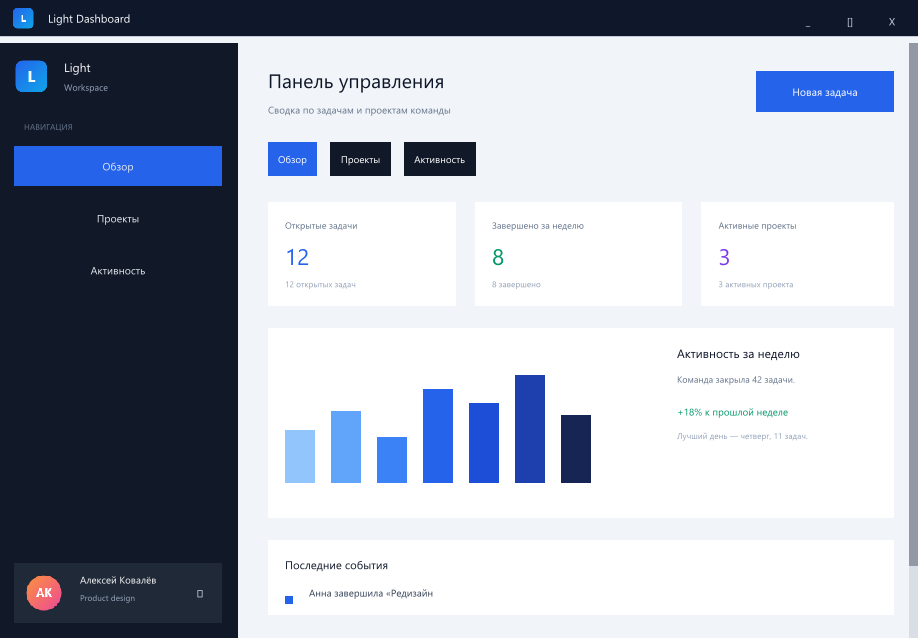

# Light

[](https://github.com/gifoff/light/actions/workflows/ci.yml)
[](https://gifoff.github.io/light/)

Light — декларативный реактивный GUI-фреймворк для Rust. Вы пишете HTML-разметку
с директивами (`v-if`, `v-for`, `v-model`), описываете состояние реактивными
свойствами (`#[proxy]`), а Light компилирует шаблоны **на этапе сборки** в
Rust-код, строящий виртуальный DOM. Окна создаются на `winit`, а программно
нарисованный кадр показывается через `softbuffer`; `wgpu` доступен отдельной
фичей `wgpu-backend`.

- **Компиляция вместо интерпретации.** Шаблоны превращаются в Rust на этапе
  сборки: в рантайме нет HTML-парсера и интерпретатора разметки.
- **Гранулярная реактивность.** Изменение свойства перерисовывает только
  зависящие узлы виртуального дерева.
- **Нативные окна.** Безрамочные окна, кастомный titlebar, модальные окна и
  несколько окон — из коробки.
- **Изображения.** PNG встраиваются в бинарник на этапе компиляции:
  `<image src="…">` и иконка окна `icon="…"` (фича `image-support`).
- **Платите только за используемое.** Каждая подсистема — Cargo-фича; код
  выключенных возможностей не попадает в бинарник.
- **Компактные бинарники.** Программный рендеринг через `softbuffer` включён
  по умолчанию: release-сборка демо занимает ~1.7 MB вместо ~7.7 MB с `wgpu`.

## Статус

Текущая версия — **0.15.5**. Проект в стадии **пре-1.0**: публичный API ещё не
стабилен и может меняться между минорными версиями.

## Быстрый старт

Создать проект с готовыми компонентами и найти сторонние можно через CLI:

```bash
cargo install light-fw-cli
light init my-app --with form --with validation
light search datepicker
```

Вручную проект собирается так:

`Cargo.toml`:

```toml
[package]
name = "my-app"
version = "0.1.0"
edition = "2021"

[dependencies]
light = { git = "https://github.com/gifoff/light" }

[features]
dev-mode = ["light/dev-mode"]
```

`src/main.rs`:

```rust
use light::prelude::*;

#[template("templates/app.html")]
#[proxy]
struct App {
    #[default("Мир".to_owned())]
    name: String,
}

impl App {
    fn greet(&self) {
        self.set_name(format!("Привет, {}!", self.name()));
    }
}

fn main() -> light::Result<()> {
    // run_with_config позволяет использовать light.config.json и DevTools
    light::run_with_config("light.config.json", App::new())
}
```

`templates/app.html`:

```html
<window title="My App" width="480" height="320">
    <div direction="vertical" padding="16">
        <h1>Привет, {{ name }}!</h1>
        <button @click="greet">Поздороваться</button>
    </div>
</window>
```

```bash
cargo run
```

### Создание проекта через CLI

Скелет проекта генерируется одной командой:

```bash
light init my-app
```

Дополнительные компоненты подключаются флагом `--with`:
```bash
light init my-app --with form --with validation
```

`form` добавляет `light-fw-element-form` и фичу `light/elements-form`,
`validation` — `light-fw-behavior-validation` и фичу `light/validation`.

### Готовые шаблоны

Вместо пустого окна можно взять showcase-приложение:

```bash
light init my-app --template counter
light init my-app --template todo
light init my-app --template calculator
```

Шаблоны и их HTML встроены в бинарник через `include_str!`. Исходники примеров
лежат в `examples/`.

## Showcase

| Calculator | Todo | Dashboard |
| --- | --- | --- |
|  |  |  |

Полноценный dashboard с изображениями, вкладками и модальным окном:

```bash
cargo run -p example-dashboard
```

### Hot Reload и DevTools

Запустите `light dev` (автоматически находит пакет в текущей папке) — Light
поднимет TCP-сервер на `127.0.0.1:9229` с JSON-снимком UI для будущего
Web UI DevTools и включит горячую перезагрузку.

```bash
light dev
```

При изменении `templates/*.html` применяется мгновенный `RELOAD_TEMPLATE` (без
пересборки). При изменении исходников `.rs` происходит инкрементальная
пересборка и подмена бинарника с сохранением состояния окна.

### Agent-friendly DevTools (0.16)

Light удобен для автономной разработки с ИИ-агентами: команда
`light devtools <cmd>` даёт агенту «увидеть» UI (дерево VDOM, раскладка,
поиск элемента, снимок состояния, скриншот) и «потрогать» его (клик, ввод
текста, клавиши) — всё по стабильным ключам узлов, а не пикселям. Флаг
`light dev --agent` автоматически пишет каждое действие в журнал сессии
(`.light/agent-sessions/<id>/actions.jsonl`) и генерирует `summary.md` при
выходе процесса — готовый артефакт для отчёта агента.

```bash
light dev --agent                 # запуск приложения под session recorder
light devtools tree               # JSON-дерево VDOM
light devtools find --tag button --text "+1"   # найти элемент → ключ + rect
light devtools click --key 0.0.0  # клик
light devtools shot --path shots  # PNG-скриншот
```

Подробности — в [`docs/guide.md`](docs/guide.md#devtools) (разделы
«CLI-обёртка `light devtools`» и «Автоматизированное тестирование с ИИ»)
и в [AGENTS.md](AGENTS.md#testing-ui-with-devtools-как-агенту-видеть-и-трогать-ui).

### Добавление компонентов

```bash
light search datepicker
light add light-fw-element-form
```

`light search` ищет компоненты на crates.io. `light add` разрешает компонент
во встроенном реестре, workspace или `vendor/`, после чего ищет на crates.io.
Фичи самого крейта передаются через `--features`:

```bash
light add light-fw-datepicker --features calendar,timezone
```

## Крейты воркспейса

| Крейт | Назначение |
| --- | --- |
| `light` | Мета-крейт: реэкспортирует ядро, макросы и подключённые компоненты. |
| `light-fw-core` | Ядро: виртуальный DOM, реактивность, раскладка, отрисовка, окно. |
| `light-fw-macros` | Процедурные макросы `#[template]` и `#[proxy]`. |
| `light-fw-html` | Разбор HTML-шаблонов для макросов. |
| `light-fw-element-form` | Компонент-элемент: `<checkbox>`, `<radio>`, `<select>`/`<option>`. |
| `light-fw-behavior-validation` | Компонент-поведение: `required`, `:validator`, `@validate`. |
| `light-fw-cli` | Утилита `light`: проверка проекта и управление компонентами. |
| `light-fw-cli-core` | Ядро CLI: анализ проекта, `light.lock`, управление компонентами. |

## Документация

Сайт: [gifoff.github.io/light](https://gifoff.github.io/light/).

- [docs/SUMMARY.md](docs/SUMMARY.md) — оглавление книги.
- [docs/ARCHITECTURE.md](docs/ARCHITECTURE.md) — обзор архитектуры для контрибьюторов.
- [docs/guide.md](docs/guide.md) — руководство пользователя.
- [docs/COMPONENT_MODEL.md](docs/COMPONENT_MODEL.md) — модель компонентов.
- [docs/COMPONENT_AUTHORING.md](docs/COMPONENT_AUTHORING.md) — как писать свои компоненты.
- [docs/EXTERNAL_COMPONENTS.md](docs/EXTERNAL_COMPONENTS.md) — краткий гайд по созданию и публикации стороннего компонента.
- [docs/RELEASING.md](docs/RELEASING.md) — публикация релиза (для мейнтейнеров).
- [docs/ROADMAP.md](docs/ROADMAP.md) — план развития.

## Лицензия

Распространяется под лицензией `MIT OR Apache-2.0` на ваш выбор. Полные тексты — в файлах [LICENSE-MIT](LICENSE-MIT) и [LICENSE-APACHE](LICENSE-APACHE).
